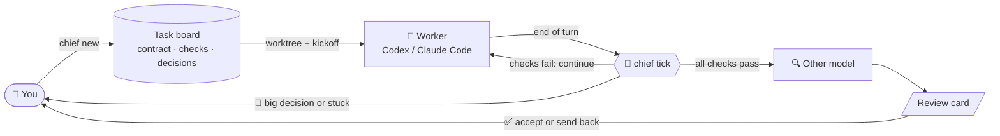

<p align="center">
  
</p>

<p align="center">
  <a href="LICENSE"></a>
  
  
  <a href="https://github.com/agent-of-empires/agent-of-empires"></a>
  <a href="https://github.com/openai/codex"></a>
  <a href="https://github.com/anthropics/claude-code"></a>
</p>

<p align="center">
  <a href="#-quick-start">Quick start</a> ·
  <a href="#-how-it-works">How it works</a> ·
  <a href="#-commands">Commands</a> ·
  <a href="docs/architecture.md">Architecture</a> ·
  <a href="rules/communication.md">Agent rules</a>
</p>

---

> **You define the task. You accept the result. Chief handles everything in between.**

You run five AI coding agents at once. One is stuck, one is waiting for an answer, one says it is "done" but its
tests fail, and two are fine. You cannot tell which is which without checking every session.

**AoE Chief** keeps watch over your [Agent of Empires](https://github.com/agent-of-empires/agent-of-empires)
sessions:

- It drives delegated tasks to completion: it runs the checks, nudges the agent forward, and reviews the result
  with a second model.
- It only interrupts you when a human decision is really needed.
- Its reports are **thin first, thick on demand**: one line per thing that matters, details when you ask.

An illustrative brief:

```text
$ chief brief
# AoE brief  10-25 01:24

**L0:** tracking 3 · needs you 1 · to confirm 1 · to accept 1 · changed 0 · unchanged 0

## 🔴 Needs you
- **csv import** `5d1c09a2` codex · idle · 4m ago
  - decide csv-import:2: Should I delete the legacy importer? Options: A) delete B) keep. Recommendation: B
  - Handle: `chief.py decide csv-import:2 --reply "your decision"`

## 📝 To confirm (drafted by chief)
- **shop demo** `84392916` codex · idle · 0m ago
  - chief drafted decision shop-demo:1: A) Plain text lines, the function is documented as human-readable
  - Handle: `chief.py decide shop-demo:1 --accept` (or `--reply "..."`)

## ✅ To accept
- **parser fix** `a8e3f0c1` codex · idle · 2m ago
  - all checks pass (2/2), ready for you to accept
  - 🤖 chief: checks 1/2: sent the failures back and asked it to continue (#1)
  - Review (claude/sonnet): pass — Trailing commas are accepted in all three grammar rules; tests untouched.
  - Accept `chief.py close parser-fix` · send back `chief.py nudge parser-fix --review`
```

## 🤔 Why

| The problem | What Chief does about it |
|---|---|
| 🧠 **One human, many agents.** Context switching between parallel sessions does not scale. | Watches every session and tells you only what changed and what needs you. |
| 🗣️ **Replies that are complete but not useful.** Agents dump everything and bury the conclusion. | A shared [communication protocol](rules/communication.md) makes agents lead with the conclusion and end each turn with a machine-readable closing block. |
| 🏁 **"Done" that is not done.** An idle process or a confident agent proves nothing. | A task is done when its **executable checks** pass and **another model** has reviewed the diff. |
| 🔁 **You are the "continue" button.** Every small nudge and decision waits for you. | Chief continues automatically on failing checks, drafts small decisions for one-command approval, and escalates only big ones. |

## ✨ Features

- **🗂️ Task contracts:** `chief new` creates a goal, checks, scope, protected paths and a budget, plus a git
  worktree and a fresh agent session.
- **✅ Objective done:** check commands decide when a task is done. Changes to protected paths, such as tests, are
  flagged, so an agent cannot pass by editing the tests.
- **📝 Decision queue:** small questions are drafted by Chief and approved with `--accept`. Big ones (push, delete,
  goal changes and the like) are always yours.
- **🔁 Auto-continue:** when checks fail, Chief sends the failing output back to the agent. It recovers
  interrupted turns and detects stuck loops.
- **♻️ Fresh context:** when a session's context fills up, a new session picks up from `.chief/progress.md`.
- **🔍 Cross-model review:** Codex's work is reviewed by Claude and vice versa, and every review produces a review
  card.
- **🧾 Learns your taste:** every override is written to `preferences.md`, and acceptance rates show what could
  be automated next.
- **📥 Terminal inbox:** `chief inbox` lists what needs you and handles it with one key: accept a draft, reply,
  send back a review, close a task, or jump into the session. Each task's state also shows as a colored dot in
  AoE.
- **🌐 English or Chinese output:** switch with `chief lang en|zh`.

## 🧭 How it works



Design principles:

1. **Read-only by default.** Chief reads AoE state, the agents' native transcripts, the tmux screen and git. It
   acts only on tasks you created with `chief new`.
2. **Rules before AI.** Deterministic rules decide what needs you. AI writes briefs, optionally drafts decisions,
   and reviews finished work.
3. **Untrusted by default.** Transcripts, screens and diffs are data, never instructions, in every AI prompt.
4. **Humans own the irreversible.** Chief never pushes, merges or deploys.

## 🚀 Quick start

**Requirements:**
- Linux or macOS, Python 3.7+ (standard library only), git
- [Agent of Empires](https://github.com/agent-of-empires/agent-of-empires) (`aoe`, tested with 1.21)
- [Codex CLI](https://github.com/openai/codex) and/or [Claude Code](https://github.com/anthropics/claude-code).
  Install both to get cross-model review.

```bash
git clone https://github.com/lialittis/AoE-Chief.git ~/aoe-chief
alias chief="python3 ~/aoe-chief/chief.py"
chief init

# Teach your agents the closing-block protocol. Merge it into existing files if you have them.
cp ~/aoe-chief/rules/communication.md ~/.claude/CLAUDE.md
cp ~/aoe-chief/rules/communication.md ~/.codex/AGENTS.md
```

### 🎮 Try the demo (about 5 minutes)

`demo.sh` creates a small shop library with three bugs and delegates it to Codex. The worker is told to fix one
test per turn and to ask before choosing the receipt format. So you get to see auto-continue, a drafted decision
and a cross review. The demo state lives in its own directory, so your real board stays clean.

```bash
~/aoe-chief/demo.sh
export AOE_CHIEF_HOME=~/.local/state/aoe-chief-demo
chief watch --every 30          # terminal 2: let Chief drive
chief inbox                     # what needs you? press a to accept the drafted decision
chief decide shop-demo:1 --accept   # the same from the command line
cat $AOE_CHIEF_HOME/tasks/shop-demo/review.md
chief close shop-demo           # or: chief nudge shop-demo "also format prices with 2 decimals"
~/aoe-chief/demo.sh clean
```

## 📅 Daily use

**Delegated tasks** have a clear goal and objective checks. Create each one as a task:

```bash
cd ~/workspace/myproj
chief new "Make the parser accept trailing commas"
# Enter accepts the draft; e opens it in $EDITOR; n aborts. --yes skips confirmation.
```

Chief infers checks from pytest configuration or `tests/` (using unittest discovery for unittest suites),
a `package.json` test script, and a Makefile `test` target. Existing `tests/` and `test/` directories become
protected. An AI reads the repo to refine the name, goal, checks, protections and budget; unavailable or failed
AI generation falls back to the inferred defaults. `--repo` selects another repository.

New tasks begin with a test phase: the worker writes failing acceptance tests, commits them, and asks you to
approve the files. This is always a big decision with no Chief draft, including in auto mode. Accept it with
`chief decide <decision-id> --accept` or `a` in the inbox to protect those tests and begin implementation.
Reply with feedback to keep revising the tests. Chief does not automatically continue or review work before
this approval. Add `--no-test-first` to begin implementation immediately.

The existing flag-based form also works, without AI drafting or a contract confirmation prompt:

```bash
chief new --repo ~/workspace/myproj --name "parser fix" \
  --goal "Make the parser accept trailing commas" \
  --check "pytest tests/parser -q" --scope src/parser --protected tests \
  --rounds 10 --hours 3          # add --dry-run to preview the contract and the kickoff prompt
chief watch --every 300          # or run it as a standing AoE session (see below)
chief inbox                      # check in whenever you like (or: chief brief)
```

### 📥 The inbox

```text
 AoE Chief · 1 needs you · 1 to confirm · 1 to accept · 4 tracked          last tick 2m ago · 14:05
 Delegated tasks
 [!] csv import            3f7b88ca  codex   idle      12m ago  protected files changed: tests/test_io.py
 [?] shop demo             f29dfc6f  codex   idle       3m ago  chief drafted decision shop-demo:1: A) plain text
 [+] parser fix            62f82720  claude  idle      40m ago  all checks pass (3/3), ready for you to accept
 Thinking sessions
 [ ] explore               9a1c03de  claude  running    0m ago
── shop demo ───────────────────────────────────────────────────────────────────────────────────────
 Decision shop-demo:1 (small, by rules)
 Q: Should receipt() return plain text lines or JSON? Recommendation: A) plain text
 Chief's draft: A) plain text
 ...
 N new task  a accept  r reply  d dismiss  n nudge  c close  o open  t tick  g refresh  q quit  ↑↓ move
```

Press `N` to delegate a task in one line, even when the inbox is empty. The selected repository is shown above
the input: it defaults to the selected item's source repository, or the current repository when none is available.
Linked worktrees and repository subdirectories resolve to the original repository. `Tab` cycles a deterministic,
deduplicated list of repositories from board tasks (including unstarted tasks), tracked sessions and the current
repository. Type the intent and press `Enter` to draft a contract in the background.

The contract appears in the detail pane. `Enter` creates and starts one task through the same lifecycle as
`chief new`; the default is to write and commit acceptance tests, then wait for your explicit approval before
implementation. Press `e` to edit the contract JSON in `$EDITOR` (default `vi`); the editor's arguments are supported.
Chief validates the result, restores the terminal and returns to the preview before starting anything. Invalid edits
or editor failures keep the last valid contract. `Esc` cancels input, a pending draft or a preview without creating a
task, branch, worktree or session; late draft results are discarded. PgUp/PgDn scroll long contracts.

Drafting and startup run in the background, and repeated submissions are ignored. Failures appear in the inbox.
After confirming startup, let it finish; if startup fails, use the reported task ID to inspect or resume it with
`chief kickoff <task-id>` instead of submitting the same contract again.

The list separates **Delegated tasks** from tracked **Thinking sessions**, with urgent items first within each
group. Arrow keys or j/k move between items and skip headings; refreshes retain the selected session.

The footer shows only the keys that apply to the selected item: `a` accept Chief's draft, `r` reply (to the pending
decision if there is one, otherwise straight to the session: guidance for a board task, your words unchanged for a
tracked session), `d` dismiss the decision, `n` send the worker guidance, `b` send the review issues back, `c` close the task as done,
`o` open the session (inside tmux it switches to the agent's tmux session; `prefix L` comes back). Sends run in the
background, so the inbox stays responsive. It refreshes every 15 seconds and never runs checks; `watch` does the
driving.

To keep the inbox and the driver as standing sessions in AoE, register them as custom agents in
`~/.config/agent-of-empires/config.toml`:

```toml
[session]
custom_agents = { chief = "python3 /home/you/aoe-chief/chief.py inbox", chief-watch = "python3 /home/you/aoe-chief/chief.py watch --every 300" }
```

```bash
aoe add ~/aoe-chief -t "chief inbox" --tool chief --launch
aoe add ~/aoe-chief -t "chief watch" --tool chief-watch --launch
```

Then tasks keep moving without a terminal of yours open, and the AoE sidebar shows whether `watch` is alive. After
updating Chief, restart these two with `aoe session stop` and `aoe session start`, not `aoe session restart`:
restart types a wake message into the session, and the inbox would read its letters as keys.

**Thinking tasks** are open-ended conversations. You talk to the agent directly. Chief can still watch those
sessions and summarize them (`chief track <session>`), but it does not drive them.

> 💡 **Answer agents through Chief** (`chief decide`), not inside the session. Every accept, override and
> dismissal is recorded. That record decides which kinds of decisions Chief may later make on its own
> (`chief decisions --stats`).

## 🧰 Commands

| Area | Command | What it does |
|---|---|---|
| 👀 Observe | `sessions`, `track`, `untrack` | Pick AoE sessions to watch |
| | `inbox [--every SEC]` | Interactive terminal inbox: one key per action |
| | `brief [--ai] [--level 1-3]` | Triage report; with `--ai`, a model writes it from the facts |
| | `show <id> [--turns N]` | Drill into one task: progress file, checks, decisions, recent turns |
| | `task <id> --goal --check ...` | Attach a goal and checks to a session you did not create with `new` |
| | `check <id>` | Run a task's checks now |
| 🗂️ Tasks | `new`, `tasks`, `kickoff`, `close [--abandon] [--remove-session]` | Task lifecycle |
| 🔁 Drive | `tick [--dry-run]`, `watch --every SEC` | One round, or a loop, of automatic actions |
| | `nudge <id> [TEXT] [--review]` | Send guidance or review issues back, and resume automation |
| | `rotate <id>`, `review <id>` | Start a fresh session now; run a cross review now |
| 📝 Decide | `decisions [--all] [--stats]` | The decision queue and acceptance stats |
| | `decide <id> --accept \| --reply TEXT \| --dismiss [REASON]` | Resolve a decision (`--redraft` / `--ai` re-judge it) |
| ⚙️ Settings | `engine [codex\|claude]`, `lang [en\|zh]` | AI engine and models per level; output language |

For `task <id>`, `--parked` suppresses inactivity reports and `--unpark` enables them again.
Omitting both flags preserves the task's parked state.

<details>
<summary><b>What <code>tick</code> does, situation by situation</b></summary>

For each active task, `tick` does at most one thing. It does nothing for tasks with `autonomy: observe`.

| Situation | Action |
|---|---|
| Any red signal, or a pending decision | Nothing; the task waits for you |
| The turn was interrupted or errored | Recover once; if it fails again, hand it to you |
| Checks fail and the turn ended | Send the failing output back and ask the worker to continue |
| The same failure `stuck_after` (3) times in a row | Mark the task stuck and hand it to you |
| `max_auto_continues` (8) continues without your input | Pause and hand it to you |
| Context use ≥ `rotate_at` (70%) | Start a fresh session in the same worktree that resumes from `.chief/progress.md` |
| All checks pass and HEAD has not been reviewed | The other model reviews the diff against the contract and writes `review.md` |

</details>

<details>
<summary><b>Configuration</b></summary>

Config lives in `$AOE_CHIEF_HOME/config.json` (default `~/.local/state/aoe-chief/`).

| Key | Default | Meaning |
|---|---|---|
| `profile` | `main` | AoE profile |
| `lang` | `en` | Output language, `en` or `zh`. The `AOE_CHIEF_LANG` environment variable overrides it. Messages to workers are always in English |
| `engine` | `codex` | AI engine for briefs and decision drafts |
| `models` | see `chief engine` | Model and effort overrides, per engine and level |
| `check_timeout` | 300 | Seconds allowed per check command |
| `scope_ignore` | `[]` | Extra patterns the scope check ignores |
| `decision_ai` | `false` | Let AI re-judge and draft new decisions |
| `stuck_after`, `max_auto_continues`, `rotate_at` | 3, 8, 70 | Automation limits |
| `review`, `review_engine`, `review_level` | `true`, the other engine, 2 | Cross review |
| `aoe_colors` | `true` | Mirror each task's state onto its AoE color dot: red needs you, amber working, green to accept |

If another program called `aoe` comes earlier in your `PATH`, Chief prefers `~/.local/bin/aoe`. You can also set
`AOE_BIN`.

</details>

<details>
<summary><b>State layout</b></summary>

```text
$AOE_CHIEF_HOME/
  config.json            settings and the sessions you track
  latest.md, reports/    the latest brief and the brief archive
  checks.json            check result cache
  preferences.md         your overrides of Chief's drafts; AI drafting reads this
  tasks/<id>/
    task.json            the contract and state
    decisions.json       the decision queue and its history
    events.jsonl         everything Chief did automatically
    review.md            the latest cross review card
<worktree>/.chief/progress.md   the worker's handoff file (git-ignored locally)
```

</details>

## 🛡️ Safety model

- 🚫 **No push, merge or deploy:** Chief never does any of these, and tells workers not to either. Accepting
  work is always your call.
- 🔐 **Checks run as you:** register only check commands you trust.
- 🧪 **Untrusted content:** transcripts, screens and diffs are treated as untrusted data in every AI prompt.
- 📁 **Trust prompts:** Codex's "trust this folder" prompt is answered only when you pass `--trust`. Claude's
  newer trust prompt wording is not recognised yet, so prefer Codex workers with `--trust`.
- 🙈 **Secrets masked:** passwords, tokens, API keys and private keys in transcripts and screens are masked as they
  are read, before Chief stores, shows or forwards anything.
- ⚖️ **Big decisions need you:** they cannot be auto-accepted. Rules flag them (pushes, deletions, test changes,
  goal or budget changes, protected paths, any red signal), and AI can only upgrade a decision from small to big,
  never downgrade one.

## 🗺️ Roadmap

- [x] **Observe:** briefs built from native transcripts, the screen and git
- [x] **A:** task contracts, `chief new`, executable checks, scope and protected paths, budgets
- [x] **B:** decision queue and suggest mode
- [x] **C:** auto-continue, recovery, stuck detection, session rotation, cross-model review
- [ ] **D:** push notifications for 🔴 items, and per-category automatic decisions unlocked by your acceptance rate
- [x] **Inbox:** an interactive terminal inbox and AoE color dots
- [x] **Intent tasks:** `chief new "<one sentence>"` with drafted contracts, and a test-first approval phase
- [x] **Secret masking** at ingestion
- [x] A test suite in the repository (`python3 -m unittest discover -s tests`)
- [x] Inbox: `N` to delegate a task in one line, and separate groups for delegated and thinking work
- [ ] Recognise Claude's newer trust prompt

The design rationale is in [docs/architecture.md](docs/architecture.md).

## 🙏 Built on

- [Agent of Empires](https://github.com/agent-of-empires/agent-of-empires): the tmux-based session manager
  Chief supervises.
- [Codex CLI](https://github.com/openai/codex) and [Claude Code](https://github.com/anthropics/claude-code): the
  workers, and each other's reviewers.

## 📄 License

[MIT](LICENSE) © 2026 Tianchi YU
