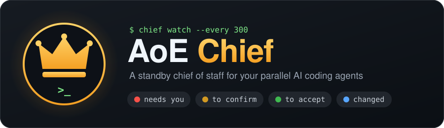
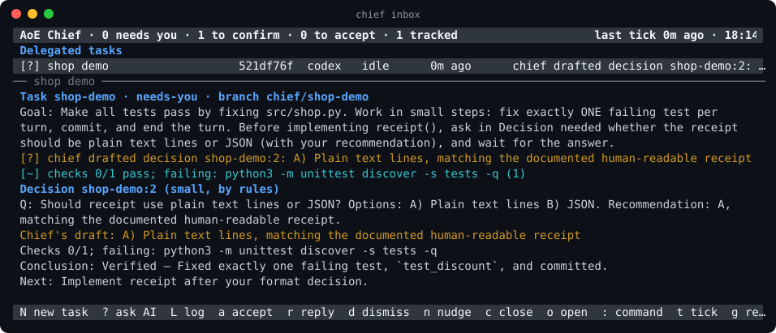
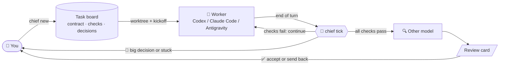

<p align="center">
  
</p>

<p align="center">
  <a href="LICENSE"></a>
  
  
  <a href="https://github.com/agent-of-empires/agent-of-empires"></a>
  <a href="https://github.com/openai/codex"></a>
  <a href="https://github.com/anthropics/claude-code"></a>
</p>

<p align="center">
  <a href="#-quick-start">Quick start</a> ·
  <a href="#-how-it-works">How it works</a> ·
  <a href="#-commands">Commands</a> ·
  <a href="docs/architecture.md">Architecture</a> ·
  <a href="rules/communication.md">Agent rules</a>
</p>

---

> **You define the task. You accept the result. Chief handles everything in between.**

You run five AI coding agents at once. One is stuck, one is waiting for an answer, one says it is "done" but its
tests fail, and two are fine. You cannot tell which is which without checking every session.

**AoE Chief** keeps watch over your [Agent of Empires](https://github.com/agent-of-empires/agent-of-empires)
sessions:

- It drives delegated tasks to completion: it runs the checks, nudges the agent forward, and reviews the result
  with a second model.
- It only interrupts you when a human decision is really needed.
- Its reports are **thin first, thick on demand**: one line per thing that matters, details when you ask.

The inbox during the demo below, captured from a real run. Chief has drafted an answer to the worker's question,
and `a` sends it:

<p align="center">
  
</p>

An illustrative brief:

```text
$ chief brief
# AoE brief  10-25 01:24

**L0:** tracking 3 · needs you 1 · to confirm 1 · to accept 1 · changed 0 · unchanged 0

## 🔴 Needs you
- **csv import** `5d1c09a2` codex · idle · 4m ago
  - decide csv-import:2: Should I delete the legacy importer? Options: A) delete B) keep. Recommendation: B
  - Handle: `chief.py decide csv-import:2 --reply "your decision"`

## 📝 To confirm (drafted by chief)
- **shop demo** `84392916` codex · idle · 0m ago
  - chief drafted decision shop-demo:1: A) Plain text lines, the function is documented as human-readable
  - Handle: `chief.py decide shop-demo:1 --accept` (or `--reply "..."`)

## ✅ To accept
- **parser fix** `a8e3f0c1` codex · idle · 2m ago
  - all checks pass (2/2), ready for you to accept
  - 🤖 chief: checks 1/2: sent the failures back and asked it to continue (#1)
  - Review (claude/sonnet): pass — Trailing commas are accepted in all three grammar rules; tests untouched.
  - Accept `chief.py close parser-fix` · send back `chief.py nudge parser-fix --review`
```

## 🤔 Why

| The problem | What Chief does about it |
|---|---|
| 🧠 **One human, many agents.** Context switching between parallel sessions does not scale. | Watches every session and tells you only what changed and what needs you. |
| 🗣️ **Replies that are complete but not useful.** Agents dump everything and bury the conclusion. | A shared [communication protocol](rules/communication.md) makes agents lead with the conclusion and end each turn with a machine-readable closing block. |
| 🏁 **"Done" that is not done.** An idle process or a confident agent proves nothing. | A task is done when its **executable checks** pass and **another model** has reviewed the diff. |
| 🔁 **You are the "continue" button.** Every small nudge and decision waits for you. | Chief continues automatically on failing checks, drafts small decisions for one-command approval, and escalates only big ones. |

## ✨ Features

- **🗂️ Task contracts:** `chief new` creates a goal, checks, scope, protected paths and a budget, plus a git
  worktree and a fresh agent session.
- **✅ Objective done:** check commands decide when a task is done. During build, changes to protected paths,
  such as tests, are flagged, so an agent cannot pass by editing the tests.
- **📝 Decision queue:** small questions are drafted by Chief and approved with `--accept`. Big ones (push, delete,
  goal changes and the like) are always yours.
- **🔁 Auto-continue:** when checks fail, Chief sends the failing output back to the agent. It recovers
  interrupted turns and detects stuck loops.
- **♻️ Fresh context:** when a session's context fills up, a new session picks up from `.chief/progress.md`.
- **🔍 Cross-model review:** Codex's work is reviewed by Claude and vice versa; Antigravity workers are reviewed
  by Codex by default. Every review produces a review card.
- **🧾 Learns your taste:** every override is written to `preferences.md`, and acceptance rates show what could
  be automated next.
- **📥 Terminal inbox:** `chief inbox` lists what needs you and handles it with one key: accept a draft, reply,
  send back a review, close a task, or jump into the session. Each task's state also shows as a colored dot in
  AoE.
- **🌐 English or Chinese output:** switch with `chief lang en|zh`.

## 🧭 How it works



Design principles:

1. **Read-only by default.** Chief reads AoE state, the agents' native transcripts, the tmux screen and git. It
   acts only on tasks you created with `chief new`.
2. **Rules before AI.** Deterministic rules decide what needs you. AI writes briefs, optionally drafts decisions,
   and reviews finished work.
3. **Untrusted by default.** Transcripts, screens and diffs are data, never instructions, in every AI prompt.
4. **Humans own the irreversible.** Chief never pushes, merges or deploys.

## 🚀 Quick start

**Requirements:**
- Linux or macOS, Python 3.7+ (standard library only), git
- [Agent of Empires](https://github.com/agent-of-empires/agent-of-empires) (`aoe`, tested with 1.21)
- A worker: [Codex CLI](https://github.com/openai/codex), [Claude Code](https://github.com/anthropics/claude-code),
  or Antigravity CLI (`agy`, transcript format based on a 1.4.11 probe).
  Chief's AI briefs, decision drafts, and reviews use Codex or Claude. Install both for mutual Codex/Claude review;
  Antigravity work uses Codex by default, or Claude when configured with `review_engine`.

```bash
git clone https://github.com/lialittis/AoE-Chief.git ~/aoe-chief
alias chief="python3 ~/aoe-chief/chief.py"
chief init

# Teach your agents the closing-block protocol. This appends, so existing instructions are kept.
mkdir -p ~/.claude ~/.codex
cat ~/aoe-chief/rules/communication.md >> ~/.claude/CLAUDE.md
cat ~/aoe-chief/rules/communication.md >> ~/.codex/AGENTS.md
```

### 🎮 Try the demo (about 6 minutes)

`demo.sh` creates a small shop library with three bugs and delegates it to Codex. The worker is told to fix one
test per turn and to ask before choosing the receipt format. The demo state lives in its own directory, so your real
board stays clean.

What you will see, in order:

1. **Test approval** (🔴): the worker first strengthens the acceptance tests and asks you to approve them. Press `a`.
2. **Auto-continue**: the worker fixes one test per turn, and Chief sends the remaining failures back each time.
3. **A drafted decision** (📝): the worker asks "plain text or JSON?" and Chief drafts the answer. Press `a` to send
   it, or `r` to reply with your own.
4. **Cross review** (✅): once the checks pass, a second model reviews the diff and writes a review card. Accept with
   `c` then `y` in the inbox, or `chief close shop-demo`.

```bash
~/aoe-chief/demo.sh
export AOE_CHIEF_HOME=~/.local/state/aoe-chief-demo
chief watch --every 30          # terminal 2: let Chief drive
chief inbox                     # press a to accept a draft or explicitly approve pending tests
chief decide shop-demo:1 --accept   # the same from the command line
cat $AOE_CHIEF_HOME/tasks/shop-demo/review.md
chief close shop-demo           # or: chief nudge shop-demo "also format prices with 2 decimals"
~/aoe-chief/demo.sh clean
```

## 📅 Daily use

**Delegated tasks** have a clear goal and objective checks. Create each one as a task:

```bash
cd ~/workspace/myproj
chief new "Make the parser accept trailing commas"
# Enter accepts the draft; e opens it in $EDITOR; n aborts. --yes skips confirmation.
```

Chief infers checks from pytest configuration or `tests/` (using unittest discovery for unittest suites),
a `package.json` test script, and a Makefile `test` target. Existing `tests/` and `test/` directories become
protected. An AI reads the repo to refine the name, goal, checks, protections and budget; unavailable or failed
AI generation falls back to the inferred defaults. `--repo` selects another repository.

Choose a worker with `--tool codex`, `--tool claude`, or `--tool antigravity` (Codex is the default):

```bash
chief new "Make the parser accept trailing commas" --tool antigravity
```

Chief passes AoE's built-in tool name `antigravity` to `aoe add`; no custom tool or command override is needed.
The inbox contract editor also accepts `"tool": "antigravity"`. Antigravity is a worker only: `--engine` and
`chief engine` still offer `codex|claude`. Automatic session rotation requires a context percentage on screen;
Chief does not estimate an agy context window from token counts.

New tasks begin with a test phase: the worker writes failing acceptance tests, commits them, and asks you to
approve the files. This is always a big decision with no Chief draft, including in auto mode. Accept it with
`chief decide <decision-id> --accept` or the Inbox action **`a approve tests`** (**`a 批准测试`** in Chinese).
This locks the listed files and discovered new test support files, then starts build. Chief finds new helpers,
`conftest.py` and fixtures inside inferred `tests/` and `test/` directories or protected test directories,
even when the worker omitted them from the approval request. Every file in the complete approval set must
exist in the worker's repository, be tracked, and match `HEAD` in both the working tree and index. Approval
preserves existing protections and uses the worker's current `HEAD` as the build scope base. Generated files
and configured `scope_ignore` exclusions remain ignored during discovery.

Use `r` to send feedback and keep the test phase. Only for a pending test approval, a reply made entirely of
consent phrases asks **`Approve the tests? [y/N]`** (**`批准测试？[y/N]`** in Chinese). Explicit `y`/`Y` uses the same
approval path as `a`; every other answer, including Enter or Escape, sends the original reply as feedback.
Recognition is case-insensitive and allows surrounding whitespace/punctuation and short combinations of:
`ok`, `okay`, `yes`, `y`, `lgtm`, `approve`, `approved`, `looks good`, `go ahead`, `可以`, `好`, `好的`, `行`, `同意`,
`批准`, `没问题`, separated by whitespace or punctuation. `okay 可以` qualifies; `ok but rename the test` sends
feedback directly without a confirmation. Other Inbox reply contexts keep their usual behavior.

`chief decide <decision-id> --reply "okay 可以"` still sends feedback, keeps the test phase, and never prompts
or approves. A localized hint explains that `--accept` approves the tests. Chief never approves tests
automatically, and does not automatically continue or review work before approval. Add `--no-test-first`
to begin implementation immediately.

During the test phase, genuinely new non-test support files appear as **yellow** review items with all their
paths listed. Existing non-test protected files, explicitly protected/approved files, and their rename sources
stay **red** when edited, deleted or renamed. A rename is not a new support-file addition; copying an unchanged
source can be. Conventional test files under inferred test directories keep their existing exemption: the
worker may edit, add, delete or rename them during the test phase unless explicitly protected as files.

During implementation, new test files under protected directories appear as **yellow** review items, with
their paths listed. Chief compares against the task's scope base, including committed, staged and untracked
additions. Existing protected files changed or deleted remain **red**, including the source of a rename.
Non-test additions under protected directories remain **red** until explicitly allowed. This also applies to
legacy tasks without a phase. Chief detects these changes in observe, suggest and auto modes, without a
worker question, and keeps one aggregate request current:
`New files in protected paths: <paths>. Allow them as task deliverables?`
For example, `tests/fast.py` is a non-test deliverable according to the existing test filename rules.

Use Inbox **`a approve paths`** (**`a 批准路径`**) or `chief decide <decision-id> --accept` even though there is no
draft. Approval persists in the task contract's `allowed` list. An **addition** allowance permits continued
editing of that exact normalized path, provided it did not exist at the task's scope base. It cannot cover
directory descendants, siblings, baseline-existing files, or explicitly protected acceptance tests/support.

After validating the displayed changes, Chief saves permission and resolves the decision before checking the
worker. A busy, stopped, missing or unavailable worker cannot block approval. The CLI and Inbox distinguish
permission granted with the worker notice delivered, notice queued, or delivery unconfirmed. Queued notices
persist across Chief restarts and are sent on a later `tick` / `watch` pass when that same worker can take input,
including in observe mode. The Inbox keeps protected approvals visible and refreshes their file snapshots
even when the worker is missing. A delivery attempt is recorded before sending: unconfirmed or interrupted delivery
has no automatic retry or resend. Check the worker's session before sending any manual follow-up;
permission remains granted regardless of delivery. Ordinary decisions and acceptance-test approvals still
require a ready worker and the original decision turn.

Existing protected modifications, deletions and renames instead queue `Allow changes to protected <paths>?`.
Accepting records each exact path's content hash, file mode, or explicit **deletion marker** (`deleted`). A
**state** approval clears its violation only while that version still matches.
Further edits need approval again and turn it red.
Rename approval includes both source and destination, including moves outside protected directories; later
changes to a moved-out file require approval again. Divergent staged and working versions must be reconciled
before state approval, so an unchanged working copy cannot hide a different staged version.

For both requests, **`r` / `--reply` is feedback only**, even for “approved” or “yes”; it grants no permission.
**`d` / `--dismiss` grants no permission** and leaves violations red. Repeated passes do not duplicate a pending
request, and a new transcript timestamp does not resolve it. Feedback/dismissal suppresses an identical request
until its paths or contents change; reverting all requested changes retires the request without permission.
Chief never drafts, auto-accepts or grants these exceptions, including with `--ai` or `--redraft`.

Approved paths, approval types and matching/changed states appear in the worker brief, Inbox detail and cross
review material, and are recorded on the review card for acceptance. Other red signals and scope boundaries
still apply. Explicitly protected acceptance tests and support files require exact state approval; addition
allowances never unlock them. This approval flow is disabled during the test phase, whose test exemptions,
support-file review and explicit approval transition to build remain unchanged.

The existing flag-based form also works, without AI drafting or a contract confirmation prompt:

```bash
chief new --repo ~/workspace/myproj --name "parser fix" \
  --goal "Make the parser accept trailing commas" \
  --check "pytest tests/parser -q" --scope src/parser --protected tests \
  --rounds 10 --hours 3          # add --dry-run to preview the contract and the kickoff prompt
chief watch --every 300          # or run it as a standing AoE session (see below)
chief inbox                      # check in whenever you like (or: chief brief)
```

### Closing and cleaning tasks

`chief close <id>` marks a task done and runs `aoe session archive` to stop its process. The archived session
record, worktree, branch and `.chief/progress.md` stay available. Add `--abandon` to mark it abandoned instead.
`chief tasks` prints complete task IDs so similar long names remain distinguishable.

```bash
chief close parser-fix
chief clean --dry-run             # preview closed tasks, skips and proposed branch actions
chief clean                       # list candidates, then confirm with y (default: no)
chief clean --branches            # also delete eligible merged branches with git branch -d
chief close parser-fix --remove-session   # preserve progress and immediately trash session/worktree
```

Cleanup finds done and abandoned tasks with sessions in the configured AoE profile, including archived
sessions. It lists each full task ID, name, branch, merge status and worktree dirtiness. A branch is merged
when its commits are contained in the task's `base_branch`, or the repository's current `HEAD` if no base
branch was set. Failed verification is shown as unknown.

Before trashing, Chief copies an existing `<worktree>/.chief/progress.md` to
`$AOE_CHIEF_HOME/tasks/<id>/progress.md`. Missing progress is allowed; a copy failure blocks that task's
removal. Dirty worktrees and worktrees whose cleanliness cannot be verified are skipped. Tracked and
untracked changes count, except `SCOPE_IGNORE` defaults and configured `scope_ignore` patterns. Chief
rechecks cleanliness immediately before removal and reports individual failures while continuing with other
candidates. Cancellation, EOF and an empty candidate list make no changes; `--dry-run` never prompts or writes.

Branches stay by default. With `--branches`, only verified merged branches are deleted after successful
session/worktree removal, using non-forced Git deletion. Unmerged, unknown and still checked-out branches
stay. `close --remove-session` also keeps the branch; it refuses dirty worktrees unless you explicitly pass
`--force`. That override does not bypass progress preservation. Sessions and worktrees go through AoE's
trash mechanism; use `aoe session restore <session-id>` to restore a session.
Chief verifies that AoE's `session.delete_to_trash` setting is enabled before invoking removal, and refuses
to report cleanup success if the worktree remains in place or the persisted session has not entered trash.
Ambiguous profile overrides are refused; use a plain boolean `session.delete_to_trash = true` declaration.

### 📥 The inbox

```text
 AoE Chief · 1 needs you · 1 to confirm · 1 to accept · 4 tracked          last tick 2m ago · 14:05
 Delegated tasks
 [!] csv import            3f7b88ca  codex   idle      12m ago  protected files changed: tests/test_io.py
 [?] shop demo             f29dfc6f  codex   idle       3m ago  chief drafted decision shop-demo:1: A) plain text
 [+] parser fix            62f82720  claude  idle      40m ago  all checks pass (3/3), ready for you to accept
 Thinking sessions
 [ ] explore               9a1c03de  claude  running    0m ago
── shop demo ───────────────────────────────────────────────────────────────────────────────────────
 Decision shop-demo:1 (small, by rules)
 Q: Should receipt() return plain text lines or JSON? Recommendation: A) plain text
 Chief's draft: A) plain text
 ...
 N new task  a accept  r reply  d dismiss  n nudge  c close  o open  t tick  g refresh  q quit  ↑↓ move
```

Press `N` to delegate a task, even when the inbox is empty. The first editable line holds the task intent and the
second holds the repository path. Up/Down (`↑`/`↓`) switches the active line, marked with `>`, keeping both buffers.
The repository defaults to the selected item's source repository, or the current repository when none is available.
Subdirectories, symlinks and linked worktrees resolve to the original source repository.

On the intent line, `Tab` cycles a deterministic, deduplicated list of repositories from board tasks (including
unstarted tasks), tracked sessions and the current repository. On the repository line, `Tab` completes directory
paths: absolute, relative and `~/` paths are supported, with spaces and quotes kept literally. A unique directory
match gains a trailing slash; ambiguous matches extend to their longest common prefix. When the repository line
is empty, repeated `Tab` cycles the same known repositories. Typing or clearing the path returns to path completion.
Hidden names are included only when the name prefix being completed starts with `.`.

Repository edits validate live in the background. The composer shows a pending or invalid state, or the resolved
Git toplevel when valid. `Enter` from either line drafts a contract only with a nonblank intent and a valid
repository; the repository is checked again before drafting. If validation is pending, `Enter` shows a checking
message and keeps both lines editable. Once validation succeeds, press `Enter` again to draft.
Invalid input stays editable and creates no artifacts.
`Ctrl-U` clears the active line and Backspace edits it. Queued paste input is processed in batches, preserving
characters and order while keeping the UI responsive, without a redraw or Git validation for every character.

The contract appears in the detail pane. `Enter` creates and starts one task through the same lifecycle as
`chief new`; the default is to write and commit acceptance tests, then wait for your explicit approval before
implementation. Press `e` to edit the contract JSON in `$EDITOR` (default `vi`); the editor's arguments are supported.
Chief validates the result, restores the terminal and returns to the preview before starting anything. Invalid edits
or editor failures keep the last valid contract. `Esc` cancels input, a pending draft or a preview without creating a
task, branch, worktree or session; late draft results are discarded. PgUp/PgDn scroll long contracts.

In the contract preview, when idle, lowercase `t` toggles **Trust this folder** for this task only.
The default is **OFF** for each task; cancelling or reopening the composer resets it to OFF. The preview line
and footer show the current state. **ON** means Chief answers the agent's trust-this-folder prompt for you in
this repository, matching `chief new --trust`. **OFF** means you confirm it in the session, then run
`chief.py kickoff <id>`. Toggling creates nothing. Your selection survives contract editing, including invalid
edits and editor failures; AI-generated or edited contract JSON never sets it.

Drafting and startup run in the background, and repeated submissions are ignored. Failures appear in the inbox.
After confirming startup, let it finish; if startup fails, use the reported task ID to inspect or resume it with
`chief kickoff <task-id>` instead of submitting the same contract again.

**Codex startup update menu:** `Update available · <old> → <new>` followed by `Update now` needs your action.
Chief never updates or skips this menu, even with `--trust`; it sends no keys or kickoff/resume text.
`Update now` runs bare `npm install -g @openai/codex`, which may use the wrong global prefix.
Upgrade Codex yourself using your intended installation method and prefix, or press `Esc` in the session to skip
the menu. Then run `chief.py kickoff <id>` (or `chief.py nudge <id>` after session rotation).
The boxed `✨ Update available! <old> -> <new>` history banner left after Esc is informational; with the normal
input box, Codex is ready. A still-open update menu below that banner continues to block Chief.

The list separates **Delegated tasks** from tracked **Thinking sessions**, with urgent items first within each
group. Arrow keys or j/k move between items and skip headings; refreshes retain the selected session.

The footer shows only the keys that apply to the selected item: `a approve tests` / `a 批准测试` approves pending
tests, locks the listed files plus discovered support files, and starts build. `a approve paths` / `a 批准路径`
explicitly allows protected deliverables or their exact changed state; `a accept` / `a 采纳` accepts Chief's draft.
The detail pane explains these actions and that `r` sends feedback and keeps the
test phase, with a confirmation for consent-only replies as described above. `r` replies to the pending
decision if there is one, otherwise straight to the session: guidance for a board task, your words unchanged for a
tracked session. `d` dismisses the decision, `n` sends the worker guidance, `b` sends the review issues back,
`c` closes the task as done, and `o` opens the session (inside tmux it switches to the agent's tmux session;
`prefix L` comes back). Sends run in the
background, so the inbox stays responsive. It refreshes every 15 seconds and never runs checks; `watch` does the
driving.

Press `?` to open a one-line **AI question box**, including on an empty board. Type a nonempty question and press
`Enter` to submit it to your configured engine/model. The detail pane shows **thinking** while generation runs in
the background; Up/Down navigation stays responsive. `Esc` dismisses an unsubmitted question or cancels active
generation, terminating its owned process and descendants and discarding late results. Recent questions and
answers remain available in the combined log described below; `?` opens a new question bar.

The **combined command and AI log** keeps the latest **20 submitted operations** in chronological submission
order in memory for this Inbox process. Each nonblank `:` command or `?` question creates one entry, updated
in place as it runs; the oldest entry is evicted at the limit. Entries retain command text, stdout/stderr,
errors, cancellation and actual exit status when available, or the question, answer, localized error,
cancellation and that answer's validated suggestions. The log survives refreshes and selection changes and
is not saved between launches. Unsubmitted or blank input does not create an entry.

A newly submitted operation shows its live result temporarily in the detail pane. Changing the selected item
dismisses that result and restores the item's details; background updates and refreshes never reopen dismissed
results. `Esc` also hides a completed result. Press uppercase `L` to open the combined log, even on an empty
board, initially at the newest entry at the bottom. `PgUp`/`PgDn` and `Space` scroll it; `Esc` leaves the log
without clearing it. Input, confirmations and active-operation cancellation keep precedence: during execution,
the first Esc cancels the owned operation, and another Esc leaves the log. Reading or scrolling the log and
pressing Enter there never submit an operation or send a reply.

The assistant is instructed to use your language, put the conclusion first and give at most three supporting points. It gets
explicit README/architecture documentation, the current board, pending decisions, recent events and review cards,
redacted with Chief's existing secret masker and enclosed as untrusted data. Generation uses `read_files=False`;
repository text and prior model answers cannot authorize actions or change Chief's rules. Command log contents
are never included in AI context.

When useful, an answer offers numbered **command suggestions**, checked against the existing command parser.
Press `1`–`9` to select a suggestion and **prefill** the `:` command bar. You can edit it or cancel with Esc;
in the combined log these digits refer to the latest AI answer, while older answers retain their own suggestions.
Only `Enter` submits the edited command, which is validated again. `close`, `clean`, `aoe session stop` and
`aoe session archive` retain their `y/N` confirmations. Asking, receiving an answer and selecting a suggestion
never execute commands, approve acceptance tests, resolve decisions or send replies. Unavailable engines,
timeouts, failed generation and unusable responses show localized errors; press `?` and submit again to retry.

After `c` successfully closes and archives a task, a second `(y/N)` confirmation offers to clean that task's
session and worktree. Enter, `n` or Esc keeps it archived. Accepting preserves progress, checks cleanliness
again and keeps the branch. A cleanup failure leaves the task closed and shows how to inspect or retry it.

Press `:` for a one-line **command bar**, with a compact cheat sheet immediately above it. It accepts
`tasks`, `show`, `new`, `decide`, `nudge`, `close`, `clean`, `track`, `untrack` and `tick`, either bare or
with an optional `chief` prefix. Existing Chief CLI flags keep their meanings. It also accepts `aoe list`
(optionally `--json`) and `aoe session show|start|stop|archive|unarchive|restore <ID>` (`show` accepts
`--json`). The configured AoE profile and `AOE_BIN` resolution apply throughout.

```text
:tasks
:chief show csv-import --turns 5
:nudge csv-import "Keep quoted commas and Unicode intact"
:decide csv-import:2 --reply "Use the existing parser"
:new "Import CSV receipts" --repo '/home/me/project with spaces'
:aoe session restore <trashed-session-ID>
```

`Tab` completes supported command names and context-appropriate task/session IDs; `decide` completes
pending decision IDs. Archived sessions complete for `unarchive`, and trashed sessions for `restore`.
Completion reads a background cache, so input stays responsive; if data is still loading, try Tab again.
Up/Down recalls per-inbox command history and restores your unsubmitted draft. Ctrl-U clears the line;
Backspace edits it. `Enter` submits once and runs the command in the background. Stdout, stderr, errors
and exit status update the operation's log entry and its transient detail view; PgUp/PgDn scroll output.
After selection changes, use `L` to read retained output. `Esc` dismisses unsubmitted input or a confirmation.
During execution it terminates the owned command process and its descendants, discarding late results.
Already completed side effects are not undone.
After completion, Esc returns to the selected task's details without removing the log entry.

`close`, `clean`, `aoe session stop` and `aoe session archive` always require explicit `y/N` confirmation,
including when flags such as `--force` or `--dry-run` are present. Enter, `n` and Esc decline. A clean's
candidate list gets its own confirmation before any removal; cleanup safeguards and branch retention
still apply. A new intent's contract is reviewed inside the inbox: Enter approves, `e` edits, `n` aborts,
and Esc cancels. Explicit `new --yes` retains its normal CLI behavior.

The command bar is restricted: quoted arguments become literal argv values. Unquoted chaining,
pipelines, redirection, globbing, variable expansion and command substitution are rejected before launch;
arbitrary executables are unsupported. Quoted punctuation is literal data, never evaluated as shell code.
Registered task checks still run through the existing check mechanism.

Use `chief console` for a tmux console: the inbox is on the **left** and an **interactive user shell**
is on the **right** by default. The shell prints the same cheat sheet first and starts in your home
directory (`~`); configure it with `chief console --shell-cwd ~/workspace`. The inbox retains its project
directory. The inbox supports narrow, half-width panes, including Unicode input, navigation, delegation,
command editing and scrolling. `chief console --layout top-bottom` places the inbox at the top and the
shell at the bottom; `--layout left-right` selects the default explicitly. `--every` sets the inbox's
refresh interval. Inside tmux, console splits the current window and runs the inbox in its original pane.
Outside tmux it creates a session, configures both panes, then attaches. Missing tmux and launcher errors
are reported on the CLI. The interactive shell supports your usual executables, pipelines and redirection;
the inbox command bar remains restricted. Use the tmux pane-switching keys to move between them.

To keep the inbox and the driver as standing sessions in AoE, register them as custom agents in
`~/.config/agent-of-empires/config.toml`. Point the custom agent named `chief` at `chief console` so
the AoE **chief inbox** session opens with the default split (use your actual absolute installation path):

```toml
[session]
custom_agents = { chief = "python3 /home/you/aoe-chief/chief.py console", chief-watch = "python3 /home/you/aoe-chief/chief.py watch --every 300" }
```

```bash
aoe add ~/aoe-chief -t "chief inbox" --tool chief --launch
aoe add ~/aoe-chief -t "chief watch" --tool chief-watch --launch
```

Then tasks keep moving without a terminal of yours open, and the AoE sidebar shows whether `watch` is alive.

**Updating Chief:** pull your updates. A running `watch` compares chief.py's content hash against its loaded
startup hash before each tick. When it changes, watch logs one line and re-executes with the same Python
interpreter and original arguments. An ongoing pass finishes before the next iteration can reload; changes
to timestamps or other metadata alone do not trigger a reload.

The Inbox compares both `chief.py` and `chief_tui.py` with their loaded startup hashes on refresh. It shows
`Chief was updated; restart this inbox: aoe session stop/start <id>` in the header, substituting the Inbox's
session ID when available. Restart the Inbox manually with separate stop and start commands; it never
restarts itself. Do not use `aoe session restart` (it types a wake message that the Inbox would read as keys):

```bash
git -C ~/aoe-chief pull
aoe session stop <ID> && aoe session start <ID>   # Inbox session; watch reloads before its next tick
```

When upgrading standing sessions that predate source-update detection, stop/start both sessions once.

**Changing `custom_agents`:** AoE stores a session's command when the session is created, so editing
`config.toml` does not change existing sessions. Remove the old session (`aoe remove <ID>`) and run the matching
`aoe add` again. A trashed session still blocks the same title and path, so use a new title (for example
`chief console`) or empty the trash (`aoe session empty-trash` purges every trashed session and cannot be undone).

**Thinking tasks** are open-ended conversations. You talk to the agent directly. Chief can still watch those
sessions and summarize them (`chief track <session>`), but it does not drive them.

> 💡 **Answer agents through Chief** (`chief decide`), not inside the session. Every accept, override and
> dismissal is recorded. That record decides which kinds of decisions Chief may later make on its own
> (`chief decisions --stats`).

## 🧰 Commands

| Area | Command | What it does |
|---|---|---|
| 👀 Observe | `sessions`, `track`, `untrack` | Pick AoE sessions to watch |
| | `inbox [--every SEC]` | Interactive terminal inbox: one key per action |
| | `brief [--ai] [--level 1-3]` | Triage report; with `--ai`, a model writes it from the facts |
| | `show <id> [--turns N]` | Drill into one task: progress file, checks, decisions, recent turns |
| | `task <id> --goal --check ...` | Attach a goal and checks to a session you did not create with `new` |
| | `check <id>` | Run a task's checks now |
| 🗂️ Tasks | `new`, `tasks`, `kickoff`, `close [--abandon] [--remove-session]` | Task lifecycle |
| | `clean [--dry-run] [--branches]` | Trash closed tasks' clean worktrees/sessions; keep branches by default |
| 🔁 Drive | `tick [--dry-run]`, `watch --every SEC` | One round, or a loop, of automatic actions |
| | `nudge <id> [TEXT] [--review]` | Send guidance or review issues back, and resume automation |
| | `rotate <id>`, `review <id>` | Start a fresh session now; run a cross review now |
| 📝 Decide | `decisions [--all] [--stats]` | The decision queue and acceptance stats |
| | `decide <id> --accept \| --reply TEXT \| --dismiss [REASON]` | Approve tests/support, protected additions or exact changed states, accept a draft, or send feedback; replies/dismissals grant no protected-path permission. `--redraft` / `--ai` never draft protected-path approvals |
| ⚙️ Settings | `engine [codex\|claude]`, `lang [en\|zh]` | AI engine and models per level; output language |

For `task <id>`, `--parked` suppresses inactivity reports and `--unpark` enables them again.
Omitting both flags preserves the task's parked state.

<details>
<summary><b>What <code>tick</code> does, situation by situation</b></summary>

For each active task, `tick` does at most one thing. It does nothing for tasks with `autonomy: observe`.

| Situation | Action |
|---|---|
| Any red signal, or a pending decision | Nothing; the task waits for you |
| The turn was interrupted or errored | Recover once; if it fails again, hand it to you |
| Checks fail and the turn ended | Send the failing output back and ask the worker to continue |
| The same failure `stuck_after` (3) times in a row | Mark the task stuck and hand it to you |
| `max_auto_continues` (8) continues without your input | Pause and hand it to you |
| Context use ≥ `rotate_at` (70%) | Start a fresh session in the same worktree that resumes from `.chief/progress.md` |
| All checks pass and HEAD has not been reviewed | The other model reviews the diff against the contract and writes `review.md` |

</details>

<details>
<summary><b>Configuration</b></summary>

Config lives in `$AOE_CHIEF_HOME/config.json` (default `~/.local/state/aoe-chief/`).

| Key | Default | Meaning |
|---|---|---|
| `profile` | `main` | AoE profile |
| `lang` | `en` | Output language, `en` or `zh`. The `AOE_CHIEF_LANG` environment variable overrides it. Messages to workers are always in English |
| `engine` | `codex` | AI engine for briefs and decision drafts |
| `models` | see `chief engine` | Model and effort overrides, per engine and level |
| `check_timeout` | 300 | Seconds allowed per check command |
| `scope_ignore` | `[]` | Extra patterns the scope and cleanup cleanliness checks ignore |
| `decision_ai` | `false` | Let AI re-judge and draft new decisions |
| `stuck_after`, `max_auto_continues`, `rotate_at` | 3, 8, 70 | Automation limits |
| `review`, `review_engine`, `review_level` | `true`, the other engine (Codex for Antigravity), 2 | Cross review using Codex or Claude |
| `aoe_colors` | `true` | Mirror each task's state onto its AoE color dot: red needs you, amber working, green to accept |
| `commands` | `{}` | Launch a tool through your own command, e.g. `{"claude": "claude-proxy"}`. See below |

If another program called `aoe` comes earlier in your `PATH`, Chief prefers `~/.local/bin/aoe`. You can also set
`AOE_BIN`.

**Native transcripts.** Chief reads worker history locally:

| Worker | Transcript location |
|---|---|
| Claude | `$CLAUDE_CONFIG_DIR/projects/*/<session-id>.jsonl` (default base `~/.claude`); follows continuation chains |
| Codex | `$CODEX_HOME/sessions/*/*/*/rollout-*-<session-id>.jsonl` (default base `~/.codex`) |
| Antigravity (`agy`) | `~/.gemini/antigravity-cli/brain/<uuid>/.system_generated/logs/transcript.jsonl` |

AoE does not store an `agent_session_id` for Antigravity. Chief resolves the session's absolute workspace path
in `~/.gemini/antigravity-cli/cache/last_conversations.json`, then reads that conversation's transcript and
`~/.gemini/antigravity-cli/annotations/<uuid>.pbtxt` title. Chief worktrees are unique per task. The mapping is
reread on each observation; Chief never selects another workspace's conversation as a fallback. Chief uses
agy's standard storage directory and does not define an undocumented `ANTIGRAVITY_HOME` environment override.

For agy prompts, only the `USER_REQUEST` body is shown; trailing metadata and settings blocks are excluded.
Untagged input is kept as raw text. The last planner response supplies the reply and closing block, while tool
calls and results update activity without masquerading as final replies. The same history feeds show, briefs,
decisions, auto-continue, recovery, and stuck detection. Missing history falls back to screen-based observation.

**Launching an agent through a wrapper.** Use `commands` when an agent must start through your own script rather
than its plain binary: an API proxy or model router, a pinned version, extra environment variables, a sandbox. The
command is used everywhere Chief starts that tool:

- `chief new` and session rotation pass it to `aoe add --cmd-override`. AoE stores it with the session, so restarts
  and resumes go through it too;
- Chief's own AI calls with that engine (Codex/Claude briefs, decision drafts, cross reviews).

A wrapper must:

1. pass every argument through. For Codex/Claude, these include AoE's `--session-id` / `--resume` and Chief's
   `-p` and `--model`;
2. `exec` the real binary, so AoE sees the agent's own process and screen;
3. keep the agent's transcript directory (`CLAUDE_CONFIG_DIR` / `CODEX_HOME`), or export the same value to Chief;
   for agy, keep the same home directory so Chief can read `~/.gemini/antigravity-cli`;
4. be on the `PATH` that tmux sessions see, or be given as an absolute path.

```bash
#!/usr/bin/env bash
# ~/.local/bin/claude-proxy: send Claude Code's API traffic through a local proxy
export ANTHROPIC_BASE_URL=http://127.0.0.1:8787
exec claude "$@"
```

Resume a conversation through the same wrapper that created it. A conversation that went through a proxy may contain
content the plain endpoint rejects.

</details>

<details>
<summary><b>State layout</b></summary>

```text
$AOE_CHIEF_HOME/
  config.json            settings and the sessions you track
  latest.md, reports/    the latest brief and the brief archive
  checks.json            check result cache
  preferences.md         your overrides of Chief's drafts; AI drafting reads this
  tasks/<id>/
    task.json            the contract and state
    decisions.json       the decision queue and its history
    events.jsonl         everything Chief did automatically
    review.md            the latest cross review card
    progress.md          progress copied before session/worktree cleanup
<worktree>/.chief/progress.md   the worker's handoff file (git-ignored locally)
```

</details>

## 🛡️ Safety model

- 🚫 **No push, merge or deploy:** Chief never does any of these, and tells workers not to either. Accepting
  work is always your call.
- 🔐 **Checks run as you:** register only check commands you trust.
- 🧪 **Untrusted content:** transcripts, screens and diffs are treated as untrusted data in every AI prompt.
- 📁 **Trust prompts:** Codex, Claude, and Antigravity folder-trust prompts are answered only when the task has
  trust enabled (`--trust`, or the inbox trust toggle). Chief verifies the affirmative menu selection before
  confirming Antigravity's `Do you trust the contents of this project?` prompt.
- ✋ **Worker approvals:** Antigravity's `Accept this file edit?` and `Run this command?` menus require your
  action in the session. Chief reports waiting for approval and never accepts these menus, even with `--trust`.
- 🙈 **Secrets masked:** passwords, tokens, API keys and private keys in transcripts and screens are masked as they
  are read, before Chief stores, shows or forwards anything.
- ⚖️ **Big decisions need you:** they cannot be auto-accepted. Rules flag them (pushes, deletions, test changes,
  goal or budget changes, protected paths, any red signal), and AI can only upgrade a decision from small to big,
  never downgrade one.

## 🧪 Tests

Run from the repository root with Python 3.7+; no Python dependencies are needed:

```bash
python3 -m unittest discover -s tests  # Full suite: the completion check
python3 tests/fast.py                 # Fast iteration
```

The fast runner uses four isolated processes and excludes exactly the three real-subprocess inbox suites
listed below. Every test from every other discovered module runs, including acceptance tests; test and import
failures produce a nonzero exit status. Normal discovery still runs the entire suite.

Measured on Python 3.7.5, Linux aarch64, HiSilicon Kunpeng-920 (96 CPUs):

| Measurement | Before | After |
|---|---:|---:|
| Full command | 169.85 s · 363 tests | 87.89 s · 376 tests |
| Fast subset | 42.57 s · 276 tests, serial | 14.97 s · 289 tests, four workers |
| `test_inbox_ai_assistant_acceptance` | 59.18 s | 20.29 s |
| `test_inbox_unified_log_acceptance` | 39.53 s | 18.11 s |
| `test_inbox_command_bar_acceptance` | 30.48 s | 17.47 s |

Full/fast values are command wall times; slow-module values are summed per-test times from complete-suite
execution audits. The fast baseline selected the same modules before `fast.py` existed. All 363 original IDs
remain collected and executed; the additional 13 are the approved latency/runner acceptance tests. Existing
tests and support files are unchanged. Both targets, full under 90 s and fast under 20 s, were met.

Inbox improvements include 10 ms active polling with 250 ms idle waits, reusable command parsers, cached
Python loading for command workers, and a lightweight owned AI supervisor. Fresh Git scans overlap while
only immutable commit data is cached. Real engines, command workers and process-tree cancellation remain exercised.

## 🗺️ Roadmap

- [x] **Observe:** briefs built from native transcripts, the screen and git
- [x] **A:** task contracts, `chief new`, executable checks, scope and protected paths, budgets
- [x] **B:** decision queue and suggest mode
- [x] **C:** auto-continue, recovery, stuck detection, session rotation, cross-model review
- [ ] **D:** push notifications for 🔴 items, and per-category automatic decisions unlocked by your acceptance rate
- [x] **Inbox:** an interactive terminal inbox and AoE color dots
- [x] **Intent tasks:** `chief new "<one sentence>"` with drafted contracts, and a test-first approval phase
- [x] **Secret masking** at ingestion
- [x] A test suite in the repository (`python3 -m unittest discover -s tests`)
- [x] Inbox: `N` to delegate a task in one line, and separate groups for delegated and thinking work
- [x] Recognise Claude's and Codex's newer trust prompts; report Codex's startup update menu without touching it

The design rationale is in [docs/architecture.md](docs/architecture.md).

## 🙏 Built on

- [Agent of Empires](https://github.com/agent-of-empires/agent-of-empires): the tmux-based session manager
  Chief supervises.
- [Codex CLI](https://github.com/openai/codex) and [Claude Code](https://github.com/anthropics/claude-code): the
  workers, and each other's reviewers.
- Antigravity CLI (`agy`): a third worker, supervised through its native transcripts and terminal prompts.

## 📄 License

[MIT](LICENSE) © 2026 Tianchi YU
